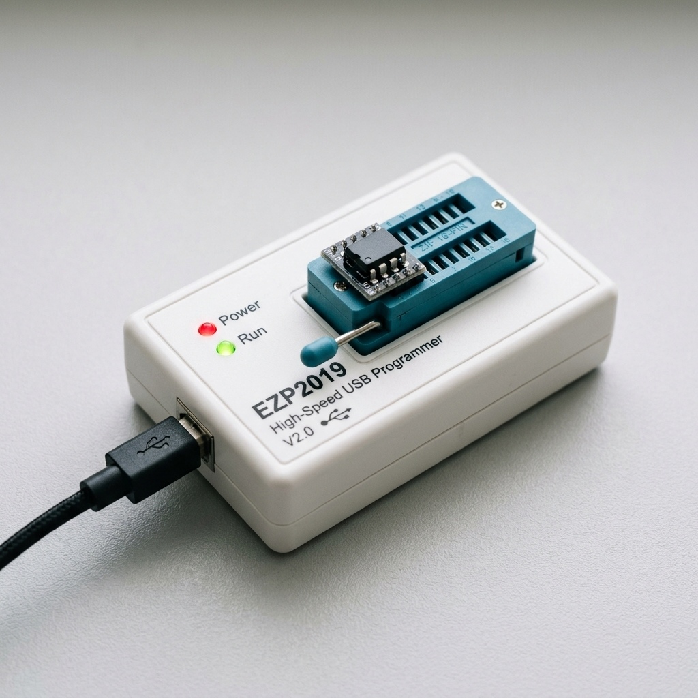

# EZP2019 USB Programmer Utility & Native Linux GUI



An open-source C driver library (`libezp2019.so`), command-line utility (`ezp2019`), and **native Linux Qt 6 Widgets GUI (`ezp2019-gui`)** for the **EZP2019 High-Speed USB Programmer**.

> **Credits & Upstream Attribution**  
> This project is based on and extends **[bokic/ezp2019](https://github.com/bokic/ezp2019)** by **Boris Barbulovski** (licensed under the MIT License), which provides the core C `libusb-1.0` driver, chip database (`ezp2019.dat`), header generator (`ezp2019_gen_header.py`), CLI utility, and Docker support.

---

## Features

### Native Qt 6 GUI (`ezp2019-gui`)
- **Direct Native Integration**: Links directly against `libezp2019.so` (`libusb-1.0`) — no CLI subprocess or text parsing.
- **Continuous USB Monitoring**: Dedicated background polling thread automatically detects programmer connect/disconnect events and USB permission errors (`LIBUSB_ERROR_ACCESS`). If permissions are missing, an explanatory dialog offers one-click `udev` rule installation via `pkexec`.
- **Non-Blocking Asynchronous I/O**: All hardware operations (`Auto-Detect`, `Read`, `Program`, `Verify`, `Erase`, and `Auto` sequence: `Erase → Program → Verify`) run in a dedicated worker thread with real-time progress updates and cooperative cancellation.
- **239 Supported Chips**: Cascading selectors (`Memory Type → Manufacturer → Model`), quick search by chip code/manufacturer/JEDEC ID, and an automatic technical specifications panel (capacity in MB/KB/Bytes, page size, voltage, JEDEC ID, and protocol).
- **Dynamic 16-Pin ZIF Socket SVG Diagram**: Highlights the exact ZIF socket pins and Pin 1 orientation (notch + dot) based on memory family (`25 SPI Flash` vs. `24/93 EEPROM`) and package (`DIP-8` direct vs. `SOIC-8` adapter), with a `1.8V adapter` warning badge when required.
- **Virtualized Hex & ASCII Editor**: Handles large 16 MB / 32 MB+ images smoothly, supports direct in-place Hex/ASCII editing (highlighting modified bytes in red), `0xFF`/`0x00` buffer fill, Hex/ASCII pattern search, **`.bin`** and **Intel `.hex`** open/save (with chip capacity mismatch alerts), and live **CRC32 / MD5** checksums in the status bar.

### Supported Hardware
- **Device**: EZP2019 High-Speed USB Programmer
- **USB VID**: `0x1fc8` | **USB PID**: `0x310b`
- **Memory Families**: `SPI Flash` (25xx), `24 EEPROM` (I²C), and `93 EEPROM` (Microwire)

---

## Dependencies

### Ubuntu / Debian
```bash
sudo apt update
sudo apt install cmake gcc g++ pkg-config python3 libusb-1.0-0-dev qt6-base-dev qt6-svg-dev
```

### Fedora
```bash
sudo dnf install cmake gcc gcc-c++ pkgconf-pkg-config python3 libusb1-devel qt6-qtbase-devel qt6-qtsvg-devel
```

### Arch Linux
```bash
sudo pacman -S cmake gcc pkgconf python libusb qt6-base qt6-svg
```

*(To build only the C library and CLI without Qt 6, omit the `qt6-*` packages and pass `--no-gui` to `./install.sh` or `-DBUILD_GUI=OFF` to CMake.)*

---

## Quick Installation (Recommended)

Use the included `install.sh` script to build in `Release` mode and install `libezp2019.so`, `ezp2019`, `ezp2019-gui`, the `.desktop` application menu entry with its vector icon, and the `udev` rule (`/etc/udev/rules.d/99-ezp2019.rules`):

```bash
./install.sh
```

Available options:
```bash
./install.sh --prefix /usr/local   # Set installation prefix (default: /usr/local)
./install.sh --no-gui              # Build and install only libezp2019 and CLI
./install.sh --no-udev             # Skip installing the udev rule
./install.sh --uninstall           # Remove installed files
```

### Manual CMake Build (without installing)
```bash
cmake -B build -DCMAKE_BUILD_TYPE=Release
cmake --build build -j$(nproc)
./build/ezp2019-gui
```

---

## USB Permissions (Linux `udev`)

Linux restricts direct USB device access for non-root users by default. To use EZP2019 without `sudo`:

1. **Automatic (from the GUI)**: When the programmer is connected without permissions, `ezp2019-gui` detects `LIBUSB_ERROR_ACCESS` and prompts you to install `/etc/udev/rules.d/99-ezp2019.rules` automatically via `pkexec`.
2. **Manual (from the terminal)**:
   ```bash
   sudo install -Dm644 99-ezp2019.rules /etc/udev/rules.d/99-ezp2019.rules
   sudo udevadm control --reload-rules
   sudo udevadm trigger --attr-match=idVendor=1fc8 --attr-match=idProduct=310b
   ```
   *(If the programmer was already plugged in, unplug and replug the USB cable if needed.)*

---

## Usage

### Graphical Interface (`ezp2019-gui`)
Launch **EZP2019 USB Programmer** from your system application menu, or run:
```bash
ezp2019-gui
```

### Command-Line Interface (`ezp2019`)
```bash
ezp2019 is_connected             # Check if the programmer is connected
ezp2019 connected_ic             # Read JEDEC ID and print connected IC info
ezp2019 read_ic > backup.bin     # Read entire IC contents to stdout
ezp2019 write_ic < firmware.bin  # Write data from stdin to the IC
ezp2019 verify_ic < firmware.bin # Verify IC contents against stdin
ezp2019 erase_ic                 # Erase the entire IC
```

### Chip Database Generator
To regenerate `ezp2019_chips.h` from an updated `ezp2019.dat` binary database:
```bash
python3 ezp2019_gen_header.py ezp2019.dat -o ezp2019_chips.h
```

---

## Credits & License

- **Original project**: [bokic/ezp2019](https://github.com/bokic/ezp2019) — Copyright (c) 2025 **Boris Barbulovski**.
- **License**: Released under the **MIT License**. See [LICENSE](LICENSE) for full details.
